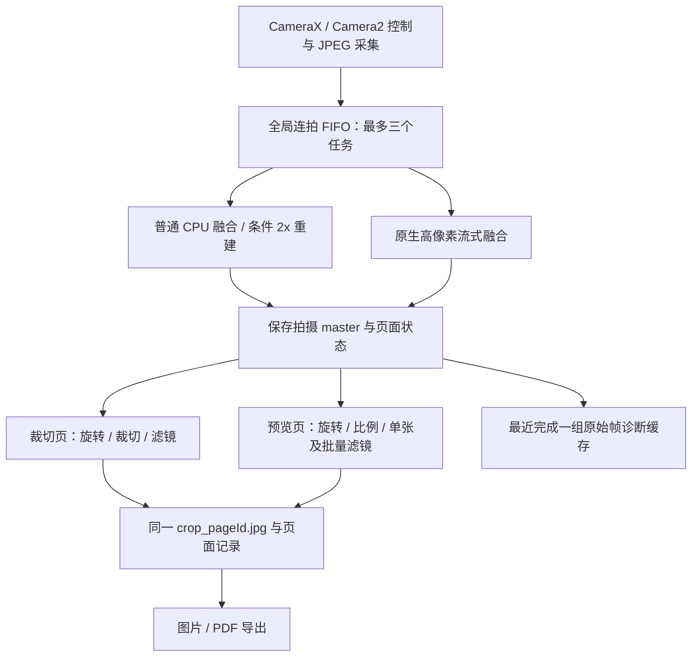

# HachiCam 架构与代码冲突审查

范围：`gpu-hdr` 当前工作树，rc9-0056 后的日间分析及待办。检查相机控制、后台队列、
普通/流式融合、裁切/预览编辑、文件提交、诊断导出和图片/PDF 导出，并核对 SPEC_00–06。
这是代码审查与失败路径推演；未修改产品实现，未声称复现实机崩溃或完成压力测试。
新的保护契约已同步写回 SPEC_00/01/04/06，不能把本报告当成实现完成。

## 结论与重构边界

适合在现有基础上局部重构。CameraX 采集、元数据匹配、局部配准、合成数学、
裁边映射和三滤镜已有可复用实现与回归。主要缺口在跨流程的任务身份、编辑所有权、
源图/结果提交、资源预算和诊断归属；继续只调锐化或 HDR 参数不能解决这些问题。
没有发现必须重写整套代码的证据。

连拍 FIFO 不包含裁切/预览的工作；图中两个编辑分支及导出目前没有统一提交边界。
以下优先级中 P0 保护源图、结果一致性与失败处理，P1 保护资源和诊断/控制可靠性。
“已确认”表示代码可直接证明路径存在；实际触发频率仍需专项验收。

## 1. P0：两套旋转语义，裁切旋转覆盖 master（已确认）

证据：`CropViewModel.kt:285–325` 对 `_imagePath` 解码、旋转后使用
`FileOutputStream(path)` 以 JPEG95 覆盖原文件，只更新局部角点。
`applyPage` 的该路径来自 `page.originalImagePath`。
`ReviewViewModel.kt:62–77` 则更新 recipe 中的 rotation，再从 master 生成衍生图。

结果：裁切旋转不是可逆 recipe；反复操作会重复 JPEG 编码。旋转后直接离开而不确认，
源图方向/尺寸已经改变，仓库中的 quad/旧 processed 文件却可能仍对应旋转前状态。
这违反 SPEC_00/04 的 master 不变与统一坐标约定。

验收 ARCH-01：两处旋转统一为 recipe，四次旋转、取消/返回/reopen 后源文件哈希不变；
角点、显示及最终导出一致。实现尚未完成。

## 2. P0：并发编辑写同一个文件，旧页面快照覆盖新设置（已确认）

证据：`ReviewViewModel.kt:85–150,198–262` 的滤镜/比例任务各自启动协程，
在任务前读取 ScannedPage，均写 `crop_<id>.jpg`，然后 `page.copy(...)` 整体发布。
`PageRepository.kt:22–24` 只是按 id 替换整个对象，没有 revision 比较。
`CropViewModel.kt:369–420` 使用相同的衍生文件名。UI 的 busy 状态不是共享互斥；
预览滤镜/比例回调也没有统一禁入或请求代数。

代码调度推演：从同一页快照发出 Paper 和比例请求；Paper 先完成，比例请求随后用
旧 filter 渲染并发布，导致新滤镜被旧快照重置。交叠写同一路径还可能使读者/EXIF
更新遇到未完成文件。这里未运行 Android 并发复现，不把可能的文件损坏说成已发生。

验收 ARCH-01/02：每页请求具有完整 recipe 和 generation，独立临时输出，提交前
核对最新版；过期任务不得修改结果字节或设置，读取/导出只使用已提交的结果修订。

## 3. P0：编辑与导出的成功判定不一致（已确认）

证据：拍摄 `CameraViewModel.kt:445–460` 检查编码成功、临时文件 rename 后提交。
裁切 `CropViewModel.kt:395–420` 和预览 `ReviewViewModel.kt:119–130,231–242`
不检查 `imwrite` 的 Boolean；裁切异常路径还会更新 quad/filter/ratio 并调用完成回调。
`FolderExporter.kt:35–56` 的 insert 或输出流为空可跳过写入后继续返回目录；
`PdfExporter.kt:22–34` 跳过缺失/无法解码的页面，输出流为空也可能返回成功路径。
`ExportViewModel.kt:45` 将普通返回视为成功。

结果：页面参数可能已更新而衍生结果仍旧/不存在；图片或 PDF 可能缺页却报告成功。
这比画质差更应优先处理，符合已有 LIFE-02 但未实现其契约。

验收 ARCH-02：false 编码、空间不足、空 URI/流、缺失输入、导出中删除均保留原有
有效状态；全部成功才报告普通成功，部分导出必须明确页数/失败项，清理未完成目标。

## 4. P1：取消边缘任务不等于阻止旧结果发布（已确认保护缺失）

证据：`CropViewModel.kt:84–95,110–149,152–163,337–355` 的线段、边缘、
点选轮廓与重检测任务完成后直接更新 Flow，没有 page/source revision 或人工编辑
代数检查。原生同步调用并不协作检查协程取消；`cancel()` 之后旧调用仍可继续到发布。
`loadPage:167–190` 仅在新页是 PROCESSING 时取消旧 pageObserveJob；若同一 VM
从等待 A 切到 READY 的 B，A 后完成仍可能 applyPage(A)。后一入口的 UI 可达性
取决于导航复用，不当作已复现用户操作。

验收 ARCH-04：延迟原生任务完成、旋转、换页、人工拖角及离开页面后，旧结果全部
丢弃且原生资源释放。`tapToSnap` 已用引用计数 Mat 快照修复直接释放竞争；
当前 QuadCropView 的 edgeMatAddr 参数没有实际 JNI 使用，不据此声称存在已确认 UAF。

## 5. P1：约 50 MP 重建绕过原生高像素的资源配置（已确认策略缺口）

证据：`CameraViewModel.kt:247–252,494–522` 按 highResolution 输入配置选择
独占 admission/流式解码；普通输入则一次解码所有帧，且始终请求条件 SR。
`fusion_pipeline.cpp:163–175` 可从 12.6 MP 输出 2× 图，随后
`saveUpright:446–459` 额外分配完整 upright。`BurstProcessor` 的单 worker
不限制裁切、预览或导出同时解码。

以本次七张 4096×3072 BGR 输入和 5920×7968 输出计算，输入 Mat 约 252 MiB，
fused 与 upright 各约 134.96 MiB；这三类同时保留已约 **521.91 MiB**。
这只是按尺寸计算的缓冲量，不是实测 RSS 峰值；尚未计压缩帧、排队输入和其他编辑。
96 MiB 压缩上限、三任务数量上限和日志中的 Java heap 均不能替代全进程预算。
此外 worker 只 catch Exception；不可恢复 Error 可结束消费者，未建立队列健康状态。
本次没有 OOM/消费者退出的实机证据。

验收 ARCH-03：按可能输出和全流程工作集预留字节，分配前再核对；不足时保留可用
原尺寸多帧融合并记录降级。一起测试排队/编辑/导出及失败后 admission 状态。

## 6. P1：诊断存在“最新开始”和“最新完成”的身份差异（已确认）

证据：`CameraViewModel.kt:258–259` 在开始 B 时清空全局诊断，
`CameraDiagnostics.kt:16–22` 拒绝不等于 activeBurst 的 A 后续记录；
原始帧缓存却在 A/B 各自处理完成后替换。
`LogCollector.kt:41–55` 先读取动态快照/日志，再另行取得缓存锁导出照片。

结果：A 尚在处理时开始 B，A 完成后的诊断缓存可以是 A，而日志页首仍是 B；
采集日志期间缓存也可能切换。manifest 自己的 captureId/帧数据仍正确，不能把
这说成缓存把 A/B 输入混合。本次 10:07 ZIP 与 P002 已匹配，没有出现此错配。

验收 ARCH-04：按导出 captureId 选择不可变每组记录；额外实时日志明确标记周边
上下文，export identity 一致。最近完成一组的保留上限属于当前明确限制。

## 7. P1：相机控制恢复失败缺少可见的未知状态（已确认）

证据：`CameraViewModel.kt:303,316` 忽略 applyOptions 的返回值；
`restoreOptions:375–379` 忽略 clear/cancel 的结果，外层继续解除 capture busy。
请求 timeout 不能证明控制已恢复，也没有相应 session/capture 结果记录。
实际帧曝光验证可以拒绝无效短帧，却不能覆盖下一次快门前的控制状态。

验收 ARCH-06：把请求确认、实际传感器证据和清理结果分开；失败后恢复/rebind
或明确降级再正常复用。不能仅凭此缺口认定 CameraX 控制互相覆盖：本次 P002
七帧焦距相同、短曝光元数据正确，正常路径已有正向证据。

## 8. P0：JNI 异常边界只在融合路径较完整（已确认）

证据：`jni_bridge.cpp:162–170,190–196` 融合入口把 std::exception 转成 Java
异常；`nativeProcessDocument:93–110`、nativeCorrectPerspective 和
nativeApplyFilter 的 OpenCV 调用没有同等 guard。几何函数也没有完整有限值、
有效 quad、输出像素/分配上限校验。Kotlin 层 catch Exception 不能替代原生异常边界。

结果：畸形输入或可恢复 OpenCV 分配/操作异常可能越过 JNI；此处确认的是保护缺失，
没有实机崩溃复现。验收 ARCH-05 覆盖连接中的 JNI 输入校验、异常翻译和资源释放。

## 不应混淆的现象与测试边界

- 12/47 MP 切换符合当前 SR 门槛，不是队列第二次运行才开启高像素的代码冲突。
- base 多帧降噪与 short 高光恢复是独立阶段；前者成功不保证后者成功。JPEG 响应
  与曝光比的偏差是后续画质调查重点，尚不能写成控制冲突的根因。
- 有普通和流式两个融合入口，各有资源/采样约束；维护时必须跑同一保护回归。
  未发现仅因函数重复就必须重写的证据。Vulkan/RAW/dense 路径未接入是已知未实现项。
- release 诊断受编译配置及独立源集隔离；本次没有发现 debug 根权限采集直接进入
  release 的证据。未进行新的二进制隐私复验，保留既有验证边界。
- 既有单元/原生测试不覆盖上述 Android 编辑并发、编码/导出故障注入、JNI 错误边界
  或全流程 RSS。此次文档变更检查不替代这些验收，也未为此重新编译 APK。

## 实施顺序

1. 源图不可变、统一旋转/坐标、每页 recipe generation 和原子结果提交一起处理，
   同步修复导出成功/失败与 JNI 边界；避免只加一个 UI busy 开关掩盖跨入口竞争。
2. 建立共享内存预算与 worker 健康状态，覆盖普通输入的 2× 输出和编辑/导出。
3. 统一每组拍摄的诊断身份与相机控制确认/恢复记录。
4. 用新的夜景原始组继续高光、文字和重建收益调查；基础状态与证据链先可靠，
   再调响应/门控和性能。相机算法无需因本审查被整体替换。
